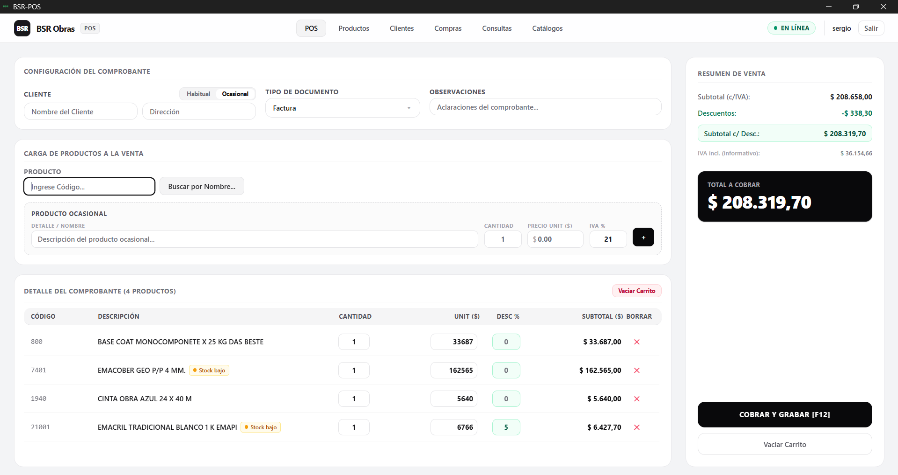
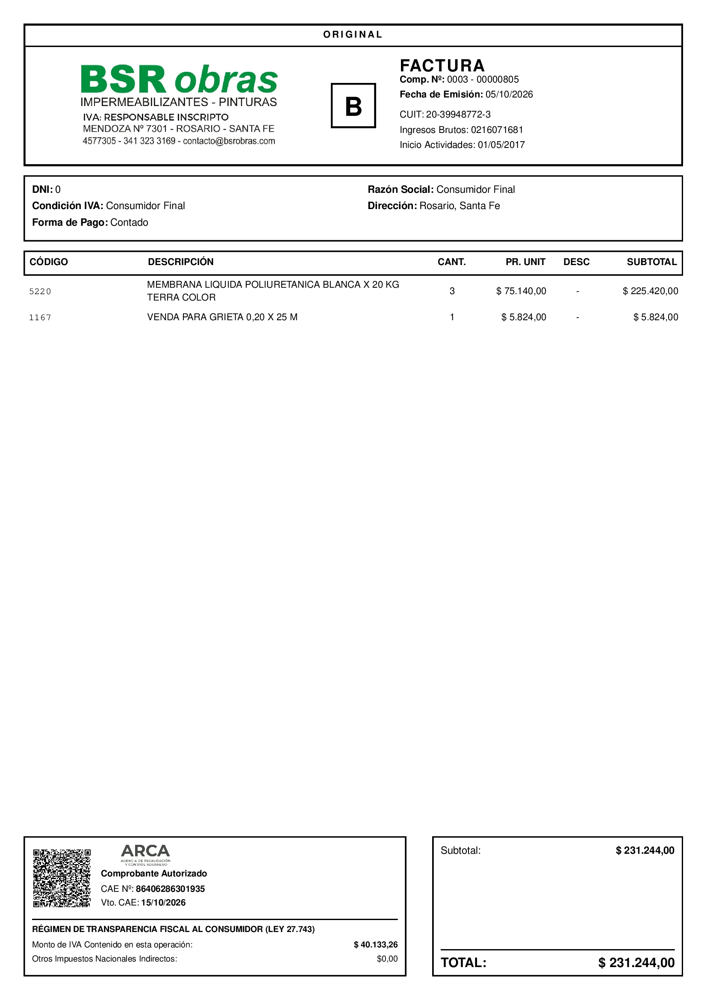
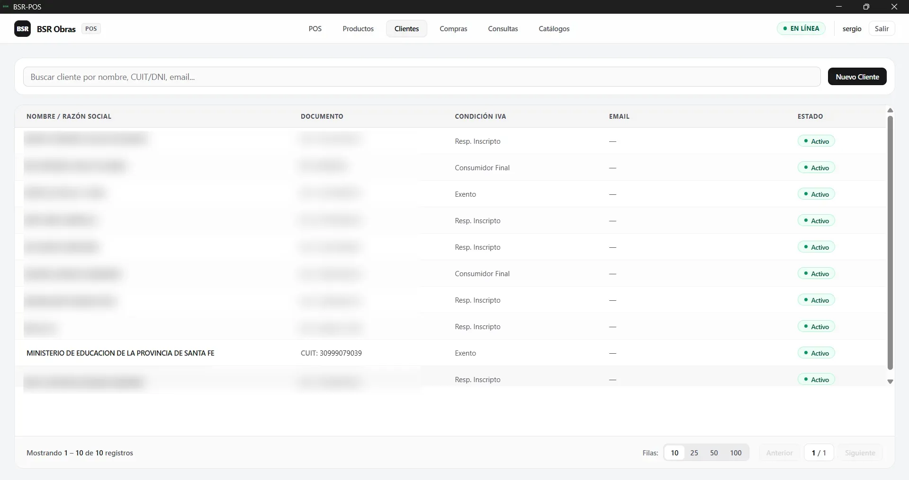
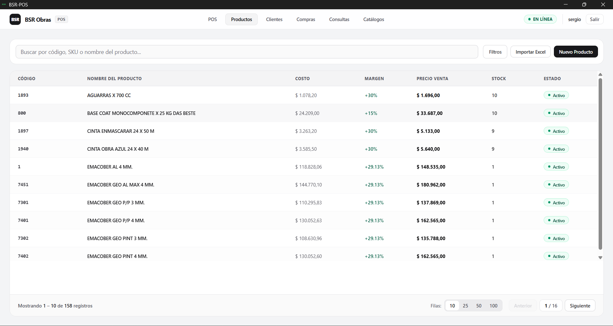
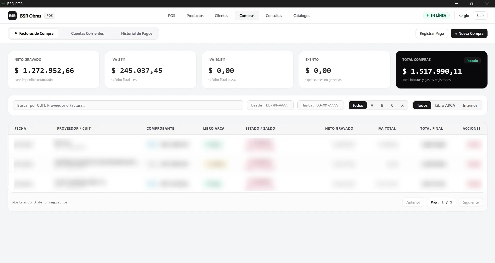
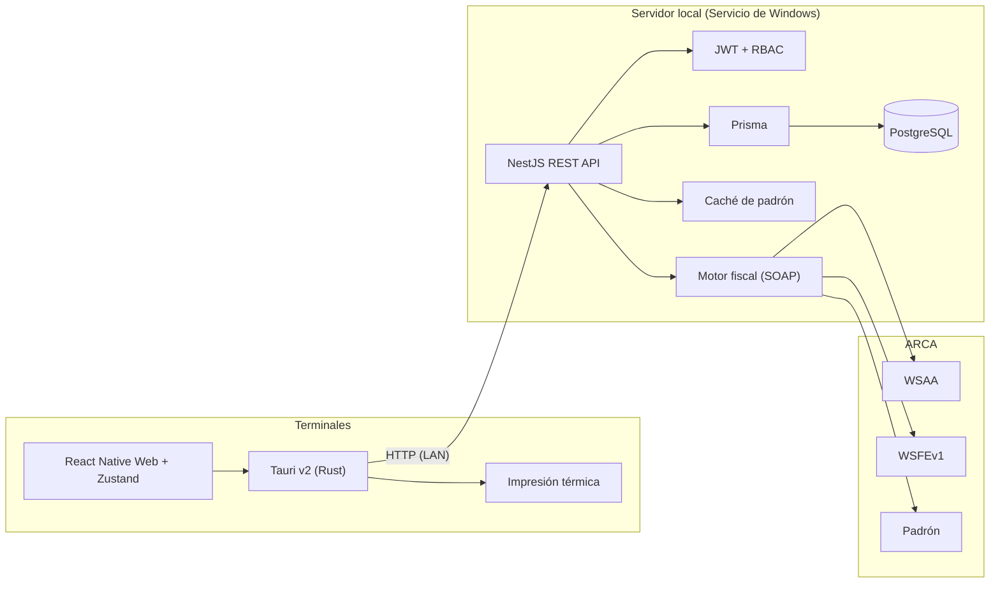

# BSR-POS

Sistema de punto de venta, facturación electrónica fiscal (ARCA, ex-AFIP) y gestión comercial para comercios minoristas y mayoristas.

**Stack:** React Native (Expo) · Tauri v2 · NestJS · Prisma · PostgreSQL · WSAA / WSFEv1
**Estado:** En producción en un comercio de pinturas e impermeabilizantes · 2 terminales · más de 150 comprobantes emitidos
**Licencia:** Propietaria. El código fuente no es público.

---

## Descripción

BSR-POS es una aplicación de escritorio con un servidor local que centraliza la facturación, el inventario y las compras de un comercio. Está pensada para operar en red local y para tratar con cuidado la comunicación con los servicios fiscales de ARCA, evitando comprobantes duplicados o inconsistentes ante cortes de red o caídas del servicio.

Soy el único desarrollador del proyecto: relevamiento, diseño, implementación, integración fiscal y despliegue.

---

## Capturas

| Punto de venta | Ticket fiscal con CAE y QR |
| :---: | :---: |
|  |  |

| Clientes y padrón | Inventario y precios |
| :---: | :---: |
|  |  |

| Compras y proveedores |
| :---: |
|  |

---

## Funcionalidades

**Ventas**
- Facturas A, B y C con CAE, comprobantes X y presupuestos, notas de crédito (con reingreso de stock) y notas de débito.
- Pago combinado: efectivo, débito, crédito y transferencia en una misma venta.
- Operación por teclado o pantalla táctil, con búsqueda por código de barras, SKU o descripción.
- Impresión silenciosa en ticketeras y generación de PDF A4.

**Facturación fiscal**
- Integración con WSAA y WSFEv1, y consulta de padrón por CUIT/DNI con caché de 48 horas.
- Código QR oficial y leyendas exigidas por las Leyes 27.618 y 27.743.
- Consolidación de alícuotas de IVA según los requisitos del webservice.

**Inventario y compras**
- Catálogo por marca, categoría y departamento, con alertas de stock mínimo.
- Precio calculado a partir de costo, descuento de proveedor, margen e IVA, con historial de cambios por usuario.
- Carga de facturas de compra con unicidad por CUIT, punto de venta, número y tipo, cuenta corriente de proveedores y base para el Libro IVA Compras.

**Seguridad**
- Autenticación con JWT y contraseñas con Bcrypt.
- Roles (`root`, `admin`, `user`) con permisos por pantalla.
- Registro del operador en cada comprobante emitido o anulado.

---

## Arquitectura

Las terminales se comunican por LAN con un backend que corre como Servicio de Windows junto a PostgreSQL. Los certificados digitales se guardan únicamente en el servidor, fuera del alcance de las cajas.

---

## Resiliencia en la facturación

- **Idempotencia.** Cada venta lleva un UUID generado en el cliente. Si la solicitud se reintenta por un problema de red, el backend reconoce la clave y no vuelve a emitir ante ARCA.
- **Conciliación de comprobantes huérfanos.** Si ARCA autoriza un CAE pero la transacción local no llega a confirmarse, el sistema consulta el comprobante con `FECompConsultar` y recupera el número y el CAE originales en lugar de emitir uno nuevo.
- **Circuit breaker.** Ante caídas o demoras prolongadas de ARCA se cortan las solicitudes salientes y se informa el error al cajero (`503`). Nunca se convierte una factura fiscal en un documento no autorizado de forma silenciosa. La venta puede continuar con un comprobante X.
- **Padrón con modo manual.** Si el servicio de padrón no responde, la interfaz permite cargar razón social y condición de IVA a mano para no detener la atención.

---

## Decisiones técnicas

- **Tauri en lugar de Electron**, para reducir el consumo de memoria en equipos de caja modestos y acceder a la impresión nativa desde Rust.
- **PostgreSQL con restricciones de unicidad a nivel base de datos**, para que la prevención de duplicados no dependa solo de la lógica de aplicación.
- **Backend como servicio del sistema**, para que se recupere solo tras cortes de energía sin requerir un usuario logueado.

## Mejoras previstas

- Régimen de contingencia CAEA para poder facturar durante caídas prolongadas de ARCA.
- Exportación completa del Libro IVA Compras Digital.

---

## Aviso

El código fuente, el esquema de base de datos y la configuración son propietarios y confidenciales. Este repositorio existe solo como documentación técnica y portfolio. Se puede coordinar una demostración en vivo o una revisión de código bajo acuerdo.

## Contacto

Federico Banqueri · federicobanqueri@hotmail.com · [LinkedIn](https://www.linkedin.com/in/federico-banqueri/)

